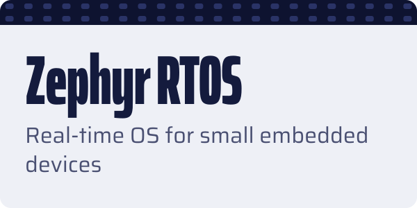
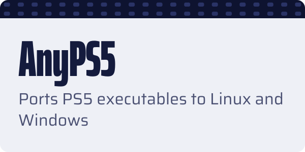

<a href="https://daxidfoto.de">
  <picture>
    <source media="(prefers-color-scheme: dark)" srcset="https://raw.githubusercontent.com/Divad27/Divad27/output/kopf-dunkel.svg">
    
  </picture>
</a>

Hi, I'm David. I ride mountain bikes, take photos along the way and write code, mostly C for small boards and some web stuff.

Most of what I build sits in private repos, so the film strip above is the short version: one frame per week, brighter means busier.

### Contributions

<a href="https://github.com/zephyrproject-rtos/zephyr/pulls?q=is%3Apr+author%3ADivad27"><picture><source media="(prefers-color-scheme: dark)" srcset="https://raw.githubusercontent.com/Divad27/Divad27/output/karte-zephyr-dunkel.svg"></picture></a>
<a href="https://github.com/boykopovar/AnyPS5/pull/23196"><picture><source media="(prefers-color-scheme: dark)" srcset="https://raw.githubusercontent.com/Divad27/Divad27/output/karte-anyps5-dunkel.svg"></picture></a>
